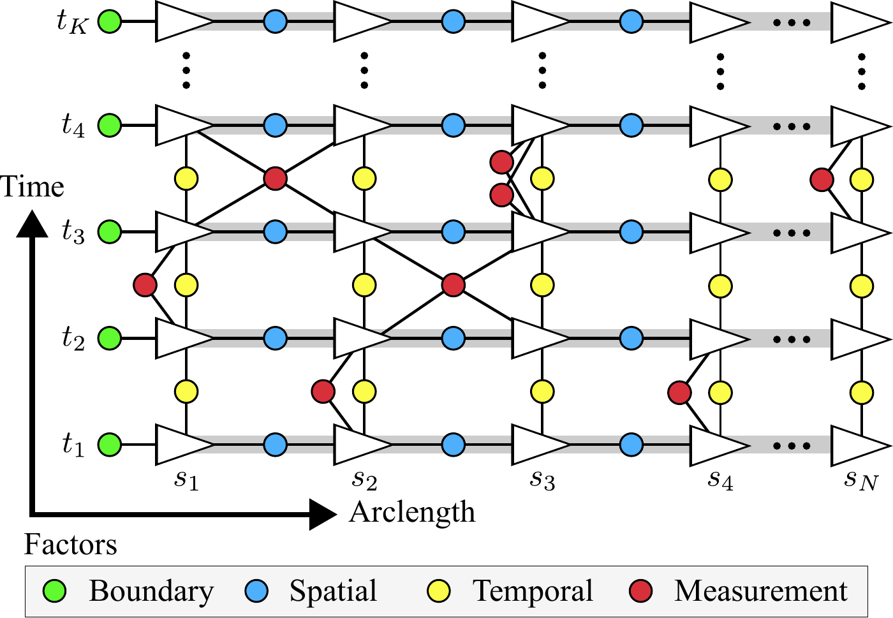
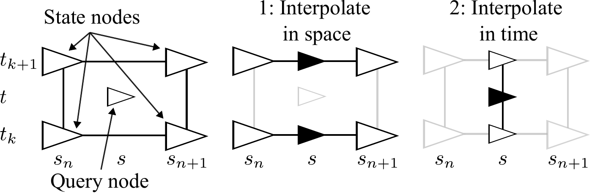
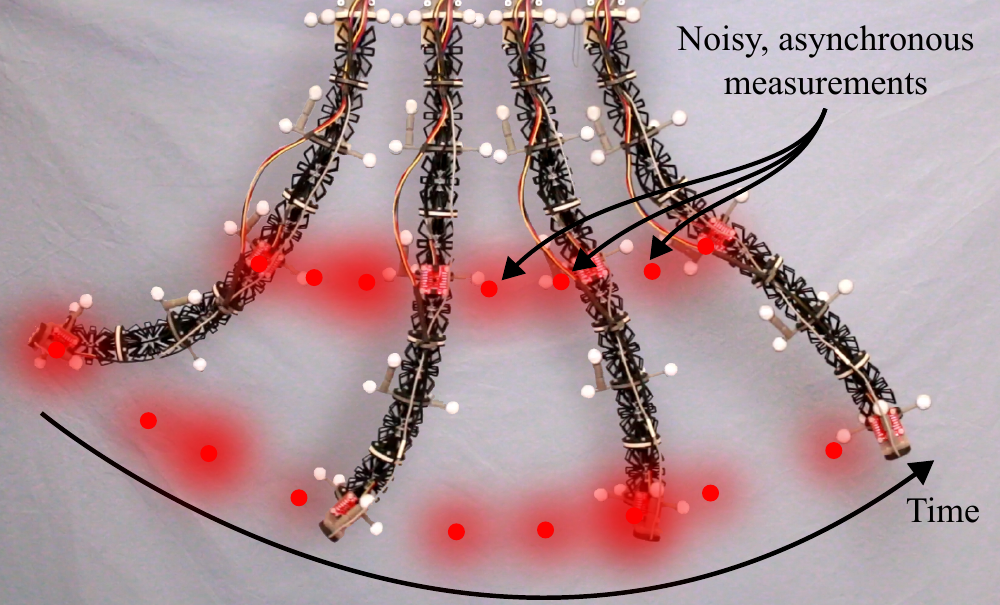
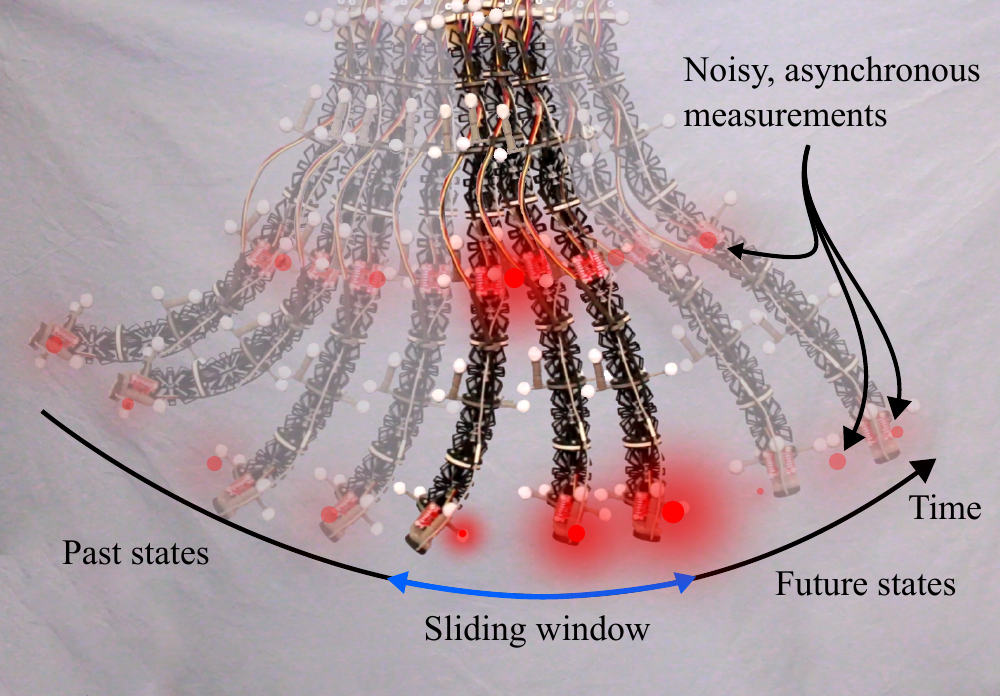
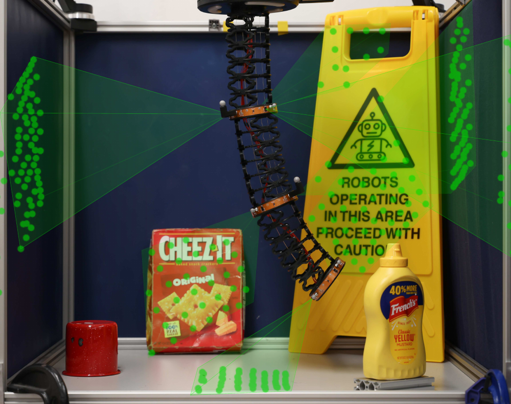

<div align="center">


<h1>Space-Time Continuum</h1>

<p>
A continuous-time-and-space state estimation framework for real-time dynamic state estimation of continuum robots.
</p>
  
<h4>
    <a href="https://arxiv.org/src/2510.26623v1/anc/results_video.mp4">View Demo</a>
    <span> · </span>
    <a href="https://github.com/utiasASRL/space_time_continuum/issues">Report Bug</a>
    <span> · </span>
    <a href="https://github.com/utiasASRL/space_time_continuum/issues">Request Feature</a>
</h4>
<h4>
    <a href="https://arxiv.org/abs/2510.01381">Paper 1</a>
    <span> · </span>
    <a href="https://arxiv.org/pdf/2510.26623">Paper 2</a>
    <span> · </span>
    <a href="https://www.roboticsproceedings.org/rss22/p050.pdf">Paper 3</a>
</h4>
</div>

<br />

<!-- Table of Contents -->
# Table of Contents

- [About](#about)
- [Getting Started](#getting-started)
  - [Prerequisites](#prerequisites)
  - [Building](#building)
  - [Running the tests](#running-the-tests)
  - [Building the documentation](#building-the-documentation)
  - [Using spacetime from another CMake project](#using-spacetime-from-another-cmake-project)
- [Usage](#usage)
  - [Core concepts](#core-concepts)
  - [A minimal example](#a-minimal-example)
  - [Threading and interfaces](#threading-and-interfaces)
    - [ROS2](#ros2)
  - [The visualizer](#the-visualizer)
  - [Joining robots](#joining-robots)
  - [Python](#python)
- [Examples and paper results](#examples-and-paper-results)
- [Contributing](#contributing)
- [FAQ](#faq)
- [Publications](#publications)
- [Contact](#contact)
- [Acknowledgements](#acknowledgements)
- [License](#license)

<br>

## About

Space-Time Continuum is a continuous-time-and-space estimator for real-time estimation of continuum robots. It runs in real time, and its accuracy is competitive with state-of-the-art estimation methods. The theory behind this work, and details on how to cite this package, are in the works listed in the [publications](#publications) section. This project remains active, with further releases expected in the coming months and years.

### Technical Description

The estimator solves a maximum a posteriori (MAP) problem by factor-graph optimization, built on [GTSAM](https://gtsam.org/). The robot's state is estimated on a grid of nodes in time and arclength. Prior factors between neighbouring nodes approximate the spatial and temporal dynamics of a Cosserat rod, and measurement factors attach each (possibly asynchronous) measurement to the nodes around it.

<p align="center">

</p>

The state (pose, strain and, depending on the prior, velocity) can be interpolated continuously in time and arclength: first in space between neighbouring nodes, then in time. This is used both during estimation, so a measurement may fall between estimated nodes, and when querying the result.

<p align="center">

</p>

Two ways of solving are supported: a batch solver and a sliding-window. The filter-based solver grows the factor graph and marginalizes old states, as shown in the figure below. The sliding-window filter of [2] is recovered by setting the marginalization window to be > 0s, whereas a classical filter is recovered by setting the window length to be = 0s.

<p align="center">

</p>

The batch solver does not marginalize. Instead, it estimates over a fixed time period in one Levenberg-Marquardt solve. Because the estimator is a factor graph, users can add custom factors for sensors and measurement models this package does not include (see [contributing](#contributing)). For a complete description of the implementation, please see our [publications](#publications).

### When to Use Each Solver

| Scenario / Requirement | Batch                                                                                                                        | Filter (0s window)                                  | Sliding Window Filter (> 0s window)                                                                                    |
|------------------------|------------------------------------------------------------------------------------------------------------------------------|-----------------------------------------|----------------------------------------------------------------------------------------------------------|
| Best for               | Offline problems with short durations that use sensors that are robust to local minima (e.g. FBGS, electromagnetic trackers) | Compute limited, real-time applications | Real-time applications using sensors that are susceptible to local minima (e.g. time-of-flight, cameras) |
| Computational cost     | High                                                                                                                         | Low                                     | Medium-Low, depending on window size                                                                      |
| Accuracy               | Highest provided a convex problem. Susceptible to local minima                                                               | Lowest                                  | Better with local minima                                                                                                     |
| `EstimatorOptions::smootherLag` | `Estimator::BATCH_LAG`                                                                                              | `0`                                     | Window length in seconds (`> 0`)                                                                         |

The sliding-window modes run GTSAM's fixed-lag smoothers. `EstimatorOptions::smoother` selects either `Smoother::Batch`, which re-solves the window with Levenberg-Marquardt at every step, or `Smoother::Incremental`, which uses iSAM2. Posterior covariances can also be extracted after every solve (`compute_covariance`).

### What is included

| Kind | Models |
|---|---|
| Priors (`spacetime/estimator/prior_models/`) | `WNOA` (white-noise-on-acceleration, dynamic), `WNOV` (white-noise-on-velocity), `WNOAQuasiStatic` (quasi-static, no velocity) |
| Sensors (`spacetime/estimator/sensor_models/`) | `PoseSensor` (full or masked 6-DoF pose, e.g. electromagnetic trackers or motion capture), `GyroSensor` (optional bias), `AccelerometerSensor`, `IMUSensor` (a gyroscope and an accelerometer sharing one frame), `FBGSensor` (strain, e.g. fiber Bragg gratings) |
| Joints (`spacetime/estimator/joint_models/`) | `Joint` (rigid or spherical joint between two robots), `EndEffector` (a rigid body several robots attach to) |
| Actuators (`spacetime/estimator/actuation_models/`) | `KinematicTendon` (a single tendon: its measured length is compared with the straight-line path through its routing disks, evenly spaced or at given arclengths), or your own `Types::ActuatorBase` |
| Other | Estimated biases (`bias_models/Bias.hpp`, e.g. an accelerometer bias or a sensor extrinsic), locked (known) states |

The `WNOA` prior can build three kinds of factors, selected with `WNOA::PriorOptions::factor_type` (or `prior.wnoa.factor_type` in a config file):

| `FactorType` | Config | Factors |
|---|---|---|
| `WNOA` (default) | `"wnoa"` | The GP prior defined on the group, as in the TRO paper (space factor of Eq. 20). `prior_models/WNOA/` |
| `Legacy` | `"legacy"` | The same group factors with the original code's strain-velocity coupling term in the space factor. This is the form from the paper's original arxiv submission. |
| `Experimental` | `"experimental"` | A GP prior defined on the Lie algebra, built from GTSAM's `WnoaMotionFactor`, `BetweenFactor` and `PriorFactor`. `prior_models/WNOA/experimental/` |

<br>

## Getting Started

This project has been developed and tested on Ubuntu 24.04 LTS. Other Linux distributions are expected to work too. Windows and macOS are not supported: the visualizer runs Qt on a worker thread, which Qt only supports on Linux.

### Prerequisites

The packages below must be installed before building. The version numbers are the ones this work was developed and tested with. Nearby versions may work, but are untested.

- [CMake](https://cmake.org/) ≥ 3.16 and a C++20 compiler
- [Eigen 3.4](https://libeigen.gitlab.io/)
- [GTSAM](https://gtsam.org/)
- [jsoncpp](https://github.com/open-source-parsers/jsoncpp)
- For the visualizer (optional, on by default): [VTK 9.3](https://vtk.org/) and [Qt 6.8.0](https://contribute.qt-project.org/)
- For the API documentation (optional): [Doxygen](https://www.doxygen.nl/) and Graphviz (`dot`)
- For the ROS2 interface (optional): a sourced ROS2 distribution
- For the Python bindings (optional): GTSAM's Python module and the packages in `python/requirements.txt` (see [Python](#python))

GoogleTest is downloaded automatically when the tests are built.

Dependencies are found through CMake's usual search, so system installs need no configuration. For a dependency installed elsewhere, such as Qt from the Qt online installer, add its prefix to `CMAKE_PREFIX_PATH`:

```bash
./build_release.sh -DCMAKE_PREFIX_PATH="$HOME/Qt/6.8.0/gcc_64"   # or export CMAKE_PREFIX_PATH=...
```

### Building

```bash
git clone https://github.com/utiasASRL/space_time_continuum
cd space_time_continuum
./build_release.sh            # --python also builds the Python bindings; -D<option> is passed on to cmake
```

`build_release.sh` configures `build/` as a Release build with the visualizer and the tests, then builds it. To choose the options yourself:

```bash
cmake -B build -DVisualizer=ON -DBuildTests=ON
cmake --build build -j$(nproc)
```

| Option | Default | Effect |
|---|---|---|
| `Debug` | `OFF` | Debug build (`-Og -g3 -Wall -Wextra`) with debug logging. Otherwise Release (`-O3`). |
| `MarchNative` | `ON` | Compile Release builds with `-march=native`. **Must match how GTSAM was built** (see below). |
| `Visualizer` | `ON` | Build the Qt/VTK visualizer. Requires `InterfaceStandalone`. |
| `BuildTests` | `ON` | Build the unit tests. |
| `InterfaceStandalone` | `ON` | Build the standalone (file playback) interface. Used by the demos. |
| `InterfaceROS2` | `OFF` | Build the ROS2 interface and the rviz2 publisher. Requires `InterfaceStandalone`. |
| `InterfaceMujoco` | `OFF` | Reserved; not implemented yet. |
| `Python` | `OFF` | Build the Python bindings. Requires `InterfaceStandalone`. |
| `Profile` | `OFF` | Add `-pg` for gprof. |

`-march=native` changes Eigen's memory alignment, so GTSAM, spacetime and any downstream project must all agree on it. A mismatch compiles fine but crashes at runtime.

### Running the tests

The C++ tests use GoogleTest and are compiled into one executable, `build/tests/tests`. The visualizer's threading tests are a separate executable, `visualizer_thread_tests`, and so are the ROS2 tests, `ros2_tests`, when `InterfaceROS2=ON`.

```bash
ctest --test-dir build/tests --output-on-failure    # every test (enable_testing() lives in tests/, so point ctest there)
./build/tests/tests --gtest_filter='JointTests.*'   # a subset of the tests
```

To run the visualizer tests without a display, set `QT_QPA_PLATFORM=offscreen`. The Python tests are described under [Python](#python).

### Building the documentation

The API documentation is generated from the docstrings in `spacetime/` by Doxygen, with this README as its main page. Doxygen and Graphviz must be installed when CMake configures the build; the `docs` target only exists if Doxygen was found.

```bash
cmake -B build                 # any options
cmake --build build --target docs
xdg-open build/html/index.html
```

The Python bindings have docstrings too, so `help()` works on them, e.g. `python -c "import spacetime; help(spacetime.Estimator)"`.

### Using spacetime from another CMake project

spacetime installs as a CMake package, so other projects (e.g. the paper reproductions in `papers/`) can build against it without depending on this repository's layout:

```bash
cmake -B build -DMarchNative=OFF -DVisualizer=ON
cmake --build build -j$(nproc)
cmake --install build --prefix <install-prefix>
```

This installs the headers to `<install-prefix>/include/spacetime`, the libraries to `<install-prefix>/lib`, and the package files to `<install-prefix>/lib/cmake/spacetime`. A downstream project then uses:

```cmake
find_package(spacetime 1.0 REQUIRED)
target_link_libraries(my_target PRIVATE spacetime::estimator)
# Every built interface (see "Selecting an interface" below)
target_link_libraries(my_target PRIVATE spacetime::interfaces)
if(spacetime_VISUALIZER)
    target_link_libraries(my_target PRIVATE spacetime::visualizer)
endif()
```

and includes the whole library, as the targets it links provide it, with one package-level header (the C++ counterpart of Python's `import spacetime`):

```cpp
#include <spacetime>
```

Every folder under `spacetime/` also has an aggregation header named after it, to include only part of the library, e.g. `#include <spacetime/estimator/sensor_models/sensor_models>` or `#include <spacetime/estimator/prior_models/WNOA/WNOA>`.

When configuring it, put spacetime on the search path. This isn't needed if spacetime was installed to a default prefix such as `/usr/local`:

```bash
cmake -B build -DCMAKE_PREFIX_PATH=<install-prefix>
```

Notes:

- `spacetime::visualizer` only exists if spacetime was built with `-DVisualizer=ON`; the package sets `spacetime_VISUALIZER` accordingly.
- `spacetime::standalone` only exists if spacetime was built with `-DInterfaceStandalone=ON` (the default); the package sets `spacetime_INTERFACE_STANDALONE` accordingly. Likewise, `spacetime::ros2` and `spacetime::rviz` only exist with `-DInterfaceROS2=ON`.
- If spacetime was built with the visualizer, `find_package(spacetime)` also finds VTK and Qt6, so they must be findable downstream too (e.g. `-DCMAKE_PREFIX_PATH="<install-prefix>;<qt-prefix>"`).
- The package sets `spacetime_MARCH_NATIVE` to how spacetime was built. Downstream projects should add `-march=native` exactly when it is true.
- Headers are included as `#include <spacetime/...>`, e.g. `<spacetime/estimator/Estimator.hpp>`.

<br>

## Usage

### Core concepts

- **State and prior.** A robot is a grid *state*, for example `Priors::WNOA::ContinuumRobotState(length, nodes)`, plus the *prior* that extends it over time. The state has a fixed number of nodes along its arclength, and it also holds *locks*, which fix a variable to a known value (e.g. a fixed base pose, `state->lock("pose", 0.0, Pose())`), or, without a value, to the initial guess the prior gives it when the node is first added (`state->lock("strain", 1.0)`). The prior adds a new row of nodes at every estimation step and the factors that link them. Each prior's `DefaultCovariances()` gives tuned covariances for its constructor (for WNOA, the experiment tuning of [1]); a prior constructed without covariances uses them, otherwise all of its covariances are passed. The state does not own its prior, so keep a reference to the prior while it is in use.
- **Node values.** Each node type's values derive from `Types::NodeValuesBase`; a prior's own are `<Prior>::NodeValues` (e.g. `Priors::WNOA::NodeValues<Pose>`, also `Prior::ValuesType`). The backbone runs along each node's body x axis: a straight robot has strain `[0, 0, 0, 1, 0, 0]` (`Priors::straightStrain<Pose>()`), which is the default strain of the node values, and a prior warns when its nominal strain has another tangent axis.
- **Models.** Everything the estimator builds factors from is a `Types::Model`: priors, sensors, actuators, joints and end effectors. Each `Estimator::estimate(time)` call runs two phases over the models, in the order they were added. First, `extendState` adds new variables (and optionally, prior factors). Then `getNewFactors` adds factors on variables that now exist. See `spacetime/estimator/types/Model.hpp`.
- **Measurements.** A sensor measures a prior's state at any (time, arclength), and is given measurements through its measurement queue (`addMeasurement`). It returns an *inner factor* on the interpolated state, and the prior wraps that in the interpolation between its neighbouring nodes. 6-vectors use GTSAM's [rotational, translational] ordering.
- **Results.** `Estimator::getCurrentValues()` returns the latest estimate. `getSnapshot()` and `waitForSnapshotNewerThan()` give thread-safe access to published results, including covariances when `compute_covariance` is set. A prior's interpolator queries its state at any (time, arclength).

### A minimal example

This example estimates one robot with a fixed base, a WNOA prior, and a pose sensor at its tip, in batch mode, through the standalone interface. The demos in `examples/` are complete versions of it (start with `examples/JointDemo.hpp`).

```cpp
#include <spacetime> // the whole library: the estimator, priors, sensors, joints and Spacetime::Session

using Pose = gtsam::Pose3;
using Prior = Spacetime::Priors::WNOA::Prior<Pose>;

// The robot: 0.4 m long with 5 nodes, its base fixed at the origin.
auto state = std::make_shared<Prior::StateType>(0.4, 5);
Prior::ValuesType reference;                                       // the prior mean: identity pose, straight strain, at rest
auto prior = std::make_shared<Prior>(state, reference);            // the tuned weights, Prior::DefaultCovariances()
// or your own weights: std::make_shared<Prior>(state, reference, Q0, Q1, Q2, Q3, Q4)
state->lock("pose", 0.0, Pose());

// A pose sensor at the tip.
Eigen::Matrix<double, 6, 6> covariance = Eigen::Matrix<double, 6, 6>::Identity() * 1e-6;
auto sensor = std::make_shared<Spacetime::Sensors::PoseSensor<Prior::ValuesType>>(prior);
const Pose measured_tip = /* e.g. from your tracker */ Pose();
sensor->addMeasurement(std::make_shared<Spacetime::Types::MeasurementBase>(
    /*arclength*/ 0.4, /*time*/ 0.5, measured_tip.matrix(), covariance, Eigen::MatrixXi::Ones(6, 1)));

Spacetime::EstimatorOptions options;
options.smootherLag = Spacetime::Estimator::BATCH_LAG;               // batch; see "When to use each solver"
Spacetime::Estimator estimator(options);
estimator.addPrior(prior);
estimator.addSensor(sensor);

// Run it offline over [0, 1] s, one node row every 1/30 s.
Spacetime::SessionOptions session_options;
session_options.end_time = 1.0;
session_options.period = 1.0 / 30.0;
Spacetime::Session session(session_options);                         // the default (standalone) interface
session.start(estimator);                                             // replays what is loaded into its sensors' queues
session.join();                                                       // batch mode is solved here
const gtsam::Values &estimate = estimator.getCurrentValues();
```

Priors, estimator options and sensor data can also be loaded from JSON configuration files with `Utilities::ConfigLoader` (`spacetime/estimator/utilities/ConfigLoader.hpp`) and replayed from CSV files with `Interface::Standalone::FileDataloader`. The paper reproduction in `papers/` is set up this way.

### Threading and interfaces

The interface layer (`spacetime/interface/`) defines what every interface builds on, and starts no threads itself: an `Interface::Clock`, `Interface::Dataloader` with a delivery watermark, an `Interface::EstimationSchedule` (when to estimate) and an `Interface::EstimatorDriver` (one `step(time)` per estimate). Each interface decides how threads are handled. The standalone interface runs these threads:

| Thread | Priority | Role |
|---|---|---|
| Control (`main()`) | default | Owns the lifecycle: builds the models, starts, stops and joins the other threads. |
| Estimator | default (highest) | `Standalone::EstimatorRunner`: steps the estimator once per period, paced by a `Standalone::PacingClock`. |
| Dataloader(s) | default | One `Standalone::ThreadedDataloader` each (e.g. `Standalone::FileDataloader`), filling the models' measurement queues. |
| Visualizer (optional, not with `--headless`) | lowered | `Visualization::Default::VisualizerThread`: owns every Qt/VTK object and reads the estimator's published snapshots. |
| Queries (optional) | lowered | Read results through `Estimator::getSnapshot()` / `waitForSnapshotNewerThan()`, or an `Interface::SnapshotHistory`. |

Offline (`Standalone::SteppedClock`), the estimator steps as fast as possible and waits at each step until every dataloader has delivered its data up to that step, so results are deterministic. In real time (`Standalone::WallClock`, `SessionOptions::real_time = true`), it never waits for data.

Interfaces are build-time options, each implementing the layer under `spacetime/interface/<name>/`:

| Option | Default | Interface |
|---|---|---|
| `InterfaceStandalone` | `ON` | Replays recorded data, either as fast as possible or in real time. Used by the demos and the Python bindings. |
| `InterfaceROS2` | `OFF` | Live (or rosbag) estimation on ROS2 nodes: an estimator node, one node per sensor, and a snapshot publisher for rviz2, all in one process. ROS executors own the threads. |
| `InterfaceMujoco` | `OFF` | Live, through Mujoco. Not implemented yet. |

**Selecting an interface.** Downstream code links `spacetime::interfaces`, includes the package-level `<spacetime>` header, and runs the estimator through `Spacetime::Session`. The interface is chosen at compile time by its template argument, one of `Spacetime::INTERFACE_STANDALONE` (the default), `Spacetime::INTERFACE_ROS2` and `Spacetime::INTERFACE_MUJOCO` (not implemented yet). Selecting an interface spacetime was built without is a compile error. A `Session` is constructed from `Spacetime::SessionOptions` and is run with `start(estimator)` / `requestStop()` / `join()` (`spacetime/interface/InterfaceConcept.hpp` documents every hook). `start(estimator)` reads the estimator's measurement queues itself, so every model and measurement added before it is covered. Measurement observers (e.g. a visualizer) can subscribe at any point and see each measurement exactly once:

```cpp
#include <spacetime>

Spacetime::SessionOptions options; // start_time, end_time, period, real_time
Spacetime::Session session(options); // the default interface; Spacetime::Session<Spacetime::INTERFACE_ROS2> for ROS2
session.start(estimator);
session.join();
```

`Spacetime::Session<I>` is that interface's own session (it derives from e.g. `Interface::Ros2::Session`), so interface-specific constructor arguments and methods are available too. In Python, `spacetime.Session` and `spacetime.SessionOptions` work the same way, and `spacetime.setInterface("ros2")` (`"default"`, `"ros2"` or `"mujoco"`) selects the interface at runtime.

#### ROS2

With `-DInterfaceROS2=ON` (build in a shell where a ROS2 distribution is sourced), `Spacetime::Session<Spacetime::INTERFACE_ROS2>` (`spacetime/interface/ros2/Interface.hpp`) runs the estimator on ROS2 nodes. It is provided as a library, with no launch files or ROS package: you write your own `main()`, which:

- calls `rclcpp::init`, builds the estimator, and creates `Spacetime::Session<Spacetime::INTERFACE_ROS2> session(options, ros_options)` (`ros_options` is an `Interface::Ros2::SessionRosOptions`)
- calls `session.addPoseSensor(...)` once per pose sensor, given the sensor's measurement queue and its `PoseSensorOptions` (parent and child TF frames, offset, arclength, covariance and mask)
- calls `session.addGyro(...)`, `session.addAccelerometer(...)` or `session.addIMU(...)` once per gyroscope, accelerometer or IMU sensor, given its queue and its `ImuSensorOptions` (topic, optional frame id, arclength, covariances and mask), and `session.addKinematicTendon(...)` once per `KinematicTendon`, given its queue and its `KinematicTendonOptions` (topic, joint name, variance, and the scale and offset from joint position to tendon length)
- optionally adds a `Spacetime::Visualization::Rviz::SnapshotPublisherNode` with `session.addNode(...)`
- then calls `start(estimator)` and `join()`

What runs:

- **Estimator node.** It estimates on a timer of the ROS clock, so it follows `use_sim_time` and a rosbag's `/clock`.
- **Pose sensor nodes.** Each reads `tf2_msgs/TFMessage` on `/tf`. Only the direct parent→child transform is matched; there is no chain lookup.
- **IMU sensor nodes.** Each reads `sensor_msgs/Imu` and queues the angular velocity (gyroscope), the linear acceleration (accelerometer) or both (IMU), in the message's sensor frame. The mounting offset belongs to the estimator sensor's options. The covariance comes from the options, or from each message with `use_message_covariance`.
- **Tendon nodes.** Each reads `sensor_msgs/JointState` and queues the position of its named joint, scaled and offset to a tendon length.
- **Snapshot publisher (optional).** It publishes `geometry_msgs/PoseArray` on `spacetime/<robot>/poses`, a `visualization_msgs/MarkerArray` on `spacetime/markers` (backbone tubes, joints, covariance ellipsoids), and the node frames on `/tf`, for rviz2.

`Spacetime::Interface::Ros2::waitForTransform()` helps to initialise a prior from TF before starting. The same API is available from Python: `spacetime.setInterface("ros2")` makes `spacetime.Session` the ROS2 session, and the ROS-specific helpers are in `spacetime.interface.ros2` and `spacetime.visualizer.rviz`.

### The visualizer

The default visualizer (`-DVisualizer=ON`) is a Qt/VTK 3D view running on its own low-priority thread. It draws the robot backbones, node frames, covariance ellipsoids, STL meshes, joints, end effectors and pose sensors. Around the view are a diagnostics overlay, a timeline (highlighting the sliding window, if any), a runtime bar (solve, graph construction and covariance timings), and an optional plot panel of the state with ±3σ bounds and ground truth, against time or arclength.

Nothing draws a ground plane by default. To get one, add a `Spacetime::Visualization::Default::GroundPlane(normal, position, size)` (position is the plane's centre, size the side of the square), call `Visualizer.addGroundPlane(visualizer.GroundPlaneOptions(...))` in Python, or set `visualizer.ground_plane` in a config and read it with `ConfigLoader::loadGroundPlaneOptions()`.

| Keys | Action |
|---|---|
| Space | Play / pause |
| ↑ / ↓ | Playback speed |
| ← / → | Step one estimation tick (offline) |
| `,` / `.` | Phase delay |
| L | Loop |
| Drag or click the timeline | Seek (offline) |
| R, `=` / `-`, O | Reset the camera, zoom, orbit |
| X | Save a screenshot to `<output>/screenshots/` |
| V | Record an mp4 of every tick to `<output>/videos/` (offline; needs ffmpeg) |
| H, Y | Toggle the panels, the timeline |
| `[` / `]`, T, C, A, G | Per robot: spatial interpolation points, temporal interpolation, covariance, node frames, meshes |
| M, J / K | Plot panel: switch mode, pick the node (or click a frame) |
| P | Toggle the ground plane (if one was added) |
| Q | Quit |

### Joining robots

A `Spacetime::Joints::Joint` (`spacetime/estimator/joint_models/Joint.hpp`) is a model that joins two robots. It holds the point at arclength `s_a` on robot A to the point at `s_b` on robot B, optionally through an offset `T_AB` (`T_B = T_A T_AB`). It softly constrains either the full pose (`JointType::Rigid`) or only the position (`JointType::Spherical`). It also constrains the velocities of the two points whenever both robots have them. The joint points may lie between nodes. The offset covariance must be positive-definite, so hard constraints are not supported. Each robot's prior is found through its state, so construct the priors first:

```cpp
auto joint = std::make_shared<Spacetime::Joints::Joint<WNOAPrior, WNOAPrior>>(
    robot_a, s_a, robot_b, s_b, offset_covariance, options); // options: type, offset, velocity_sigma_floor
estimator.addModel(joint);
```

Several robots can also attach to one `Spacetime::Joints::EndEffector` (`spacetime/estimator/joint_models/EndEffector.hpp`). This is a rigid body with no length, holding only a pose and a velocity, linked over time by GTSAM's WNOA motion factors. It has no anchor of its own: the robots attached to it position it, and estimating it with none attached throws. It owns its prior and its joints, so a single `addModel` registers all of them:

```cpp
auto platform = std::make_shared<Spacetime::Joints::EndEffector<gtsam::Pose3>>(initial_pose);
platform->attach(robot_prior, s, offset_covariance, options); // options.offset = T_point_ee; returns the Joint
estimator.addModel(platform);
```

### Python

The `spacetime` Python package exposes the library: the priors (`priors.wnoa`, `priors.wnov`, `priors.wnoa_quasi_static`, each with its `NodeValues`, grid state, `Prior` and `DefaultCovariances()`), sensors, actuators (`actuators.KinematicTendon`), joints and end effectors, the estimator, the standalone session and the visualizer, with all of their options. GTSAM objects (`gtsam.Pose3`, `gtsam.Values`, factors, noise models) are GTSAM's own Python types. So GTSAM's Python module must be installed, and it must be built from the same GTSAM as the C++ library (`GTSAM_BUILD_PYTHON=ON`). The bindings must be built with the pybind11 version GTSAM's wrapper uses, which is pinned in `python/requirements.txt`.

```bash
pip install -r python/requirements.txt
./build_release.sh --python         # builds the bindings and pip-installs `spacetime` (into .venv if present, else $PYTHON or python3)
python -m pytest python/tests       # the Python tests
```

#### Prebuilt wheels (e.g. Google Colab)

Each release has prebuilt wheels for Linux x86_64 (Python 3.10–3.13), which is also what Google Colab runs. Nothing gets compiled when you install one:

```bash
pip install spacetime -f https://github.com/utiasASRL/space_time_continuum/releases/expanded_assets/v1.0.0
```

In a Colab cell, prefix the command with `!`. The wheel bundles a `gtsam` module built from the same GTSAM 4.3.0 as the bindings (without TBB and Boost), so **don't** also `pip install gtsam`, which would replace it. The wheels are built with `MarchNative=OFF` and without the visualizer and ROS2. `.github/workflows/wheels.yml` builds them for each `v*` tag with [cibuildwheel](https://cibuildwheel.pypa.io) (`pyproject.toml`, `ci/cibw_before_all.sh`).

`pip install .` from a checkout builds the bindings from source with scikit-build-core instead. For that, GTSAM (with its Python module installed in the same environment), Eigen 3.4 and jsoncpp must be findable by CMake.

Every C++ base class can be subclassed in Python:

- `types.Model`
- `types.SensorBase` (override `getFactor`)
- `types.ActuatorBase`
- `types.StatefulModel` (e.g. a prior: override `extendState`)
- `types.State`, `types.NodeBase` and `types.NodeValuesBase`
- the built-in priors and sensors

`types.Robot` is a plain list of models, for `Estimator.addRobot`. Python models build their factors from existing C++ factors, either GTSAM's (e.g. `gtsam.PriorFactorPose3`) or the library's (`sensors.PoseFactor`, `sensors.StrainFactor`, `sensors.GyroFactor`), so factor evaluation stays in C++:

```python
import gtsam
from spacetime import sensors, types

class MyPoseSensor(types.SensorBase):
    def getFactor(self, measurement):
        noise = gtsam.noiseModel.Gaussian.Covariance(measurement.covariance)
        return sensors.PoseFactor(noise, gtsam.Pose3(measurement.value), measurement.mask)
```

As in C++, a robot is its grid state (e.g. `wnoa.ContinuumRobotState(length, nodes)`, which holds its locks) plus the prior that extends it, and sensors, actuators and joints are built on the prior. A state does not own its prior, so keep a reference to each prior while it is in use. `python/examples/kinematic_tendon.py` puts these together:

```python
import numpy as np
from spacetime import *

estimator = Estimator()
state = priors.wnoa.ContinuumRobotState(length=1.0, spatial_dim=5)
state.lock("pose", 0.0)    # without a value: held at its initial guess
prior = priors.wnoa.Prior(state, priors.wnoa.NodeValues())  # the default covariances, wnoa.DefaultCovariances()
estimator.addPrior(prior)

tendon = actuators.KinematicTendon(prior, radius=0.01, angle=0.0, termination=1.0, discretization=0.2)
# or through disks at chosen arclengths: actuators.KinematicTendon(prior, radius=0.01, angle=0.0, arclengths=[0.0, 0.3, 0.8, 1.0])
tendon.addMeasurement(types.MeasurementBase(time=0.0, value=1.1, covariance=1.0))  # a tendon length
estimator.addActuator(tendon)

session = Session()
session.start(estimator)
session.join()
```

<br>

## Examples and paper results

The C++ demos are built into `build/examples/` along with the standalone interface. Each runs a batch estimate, prints how well every joint holds, and replays the result in the visualizer. `--headless` skips the visualizer, and `--output <dir>` writes the estimate to `<dir>` (used by the Python regression test).

```bash
./build/examples/robot_joining [--headless]           # robot A's tip joined to robot B's mid-point through a short link; B is driven into an S shape
./build/examples/stewart_gough [--headless]           # six legs of a Stewart-Gough platform, their tips attached to an end effector, actuated by elongation
./build/examples/robot_joining_parallel [--headless]  # two fixed-base legs whose tips share an end effector, swung 27 cm sideways; only the end effector's pose is measured
./build/examples/bucky_ball [--headless]              # stress test: a bucky ball of 90 robots joined through 60 end effectors, pressed from the top
```

In the visualizer, a joint is drawn as a black cylinder between the joined points, or as a black sphere when it has no offset. An end effector is drawn as a coordinate frame. `N` toggles the joints, `E` the end-effector frames, `B` the robot backbones, and `S` the sensors.

The demos have Python ports in `python/examples/` (`robot_joining.py`, `robot_joining_parallel.py`, `stewart_gough.py`, `bucky_ball.py`, with the same options). `custom_sensor.py` shows a sensor and a model written in Python, and `kinematic_tendon.py` a robot with a pose sensor and a tendon. `python/tests/test_demo_regression.py` checks that the Python ports reproduce the C++ demos' estimates.

`papers/` holds a self-contained reproduction of each publication's results, with its own data, configurations, runner and scripts. These build against the installed spacetime package (see [Using spacetime from another CMake project](#using-spacetime-from-another-cmake-project)). At present, it contains the reproduction of [1] (`papers/a-stochastic-framework-for-continuous-time-estimation-of-continuum-robots/`, see its README). Small changes to the code base since publication cause small deviations from the published numbers, but the conclusions of each work are unchanged. Older versions of the project used in each work are available on request.

<br>

## Contributing

We are open to contributions from third parties!

### Adding a new sensor or measurement factor

If you have developed a new sensor model that you think others would find useful, feel free to open a pull request with it! A sensor derives from `Spacetime::Types::SensorBase` (`spacetime/estimator/types/SensorBase.hpp`) and implements `getFactor(measurement)`. This returns a GTSAM factor on the interpolated keys of the node type it measures (e.g. `ValuesT::InterpolatedKeys::Pose()`), and the prior handles the interpolation. See `PoseSensor`, `GyroSensor` and `FBGSensor` in `spacetime/estimator/sensor_models/` for reference. Check your factor's Jacobians numerically; `tests/NumericalDifferentiation.hpp` helps with this. In your pull request please include:

- The sensor, with its factor, in a single `spacetime/estimator/sensor_models/<SensorName>.hpp` file
- Docstrings, including at the top of the file a description of what the sensor is for, and any requirements on the data format, hardware, etc.
- Unit tests in `tests/<SensorName>Tests.cpp`
- \[Optional\] Information at the top of the file on how to cite you

### Adding a new actuator

An actuator derives from `Spacetime::Types::ActuatorBase` (`spacetime/estimator/types/ActuatorBase.hpp`) and overrides one method, `getFactors(measurement, input_key)`. Each measurement becomes an input variable (`input_key`), and `getFactors` returns its inner factors: each on the prior's interpolated keys at any of the actuator's arclengths, through the point-indexed keys (`Keys::Pose(i)` is the pose at `arclengths()[i]`), and on the input. One factor per point acts at each point independently; one factor on several points acts on all of them at once, as `KinematicTendon`'s tendon length does over its routing disks; the base interpolates them for you. In Python:

```python
class StrainActuator(types.ActuatorBase):
    def getFactors(self, measurement, input_key):
        noise = gtsam.noiseModel.Isotropic.Sigma(6, 1e-3)
        return [gtsam.CustomFactor(noise, [wnoa.InterpolatedKeys.Strain(i), input_key], strain_minus_input)
                for i in range(len(self.arclengths()))]
```

Put it in `spacetime/estimator/actuation_models/<ActuatorName>.hpp` (and add it to that folder's `actuation_models` aggregation header), with unit tests in `tests/<ActuatorName>Tests.cpp`, as for a sensor.

### Other contributions

Please [open an issue](https://github.com/utiasASRL/space_time_continuum/issues) to raise collaboration ideas and feature requests.

<br>

## FAQ

<details>
<summary><strong>Who is this project for?</strong></summary>

The project in its current state remains research focused. It is meant for people who work in state estimation, or who otherwise need a stochastic state estimator in their work.

</details>

<details>
<summary><strong>Is this code production-ready?</strong></summary>

This code has been used and tested in a research environment. The system is fast enough to run in real time, and interfaces for live use are provided (see [Threading and interfaces](#threading-and-interfaces)). Even so, caution is advised for researchers wishing to use this repository in closed-loop control applications, as no formal safety guarantees are provided. If you are a researcher looking to use it in such an application, feel free to reach out to see if a collaboration is possible.

</details>

<details>
<summary><strong>How do I cite this work?</strong></summary>

See the [Publications](#publications) section of this README.

</details>

<details>
<summary><strong>I found a bug — what should I do?</strong></summary>

Please open an issue:
https://github.com/utiasASRL/space_time_continuum/issues

</details>


<br> 

## Publications

If you find this repository useful in your work, please consider citing the contributions that have made this repository possible.

---

### 📕 [1] A Stochastic Framework for Continuous-Time State Estimation of Continuum Robots

**Spencer Teetaert, Sven Lilge, Jessica Burgner-Kahrs, and Timothy D. Barfoot (2025)**

❓ This is the seminal work, introducing the batch estimation framework implemented in this repository. It has been accepted to IEEE Transactions on Robotics and will appear shortly.

<p align="center">

</p>

🔗 [https://arxiv.org/abs/2510.01381](https://arxiv.org/abs/2510.01381)


<details>
<summary>Abstract</summary>
State estimation techniques for continuum robots (CRs) typically involve using computationally complex dynamic models, simplistic shape approximations, or are limited to quasi-static methods. These approaches can be sensitive to unmodeled disturbances acting on the robot. Inspired by a factor-graph optimization paradigm, this work introduces a continuous-time stochastic state estimation framework for continuum robots. We introduce factors based on continuous-time kinematics that are corrupted by a white noise Gaussian process (GP). By using a simple robot model paired with high-rate sensing, we show adaptability to unmodeled external forces and data dropout. The result contains an estimate of the mean and covariance for the robot's pose, velocity, and strain, each of which can be interpolated continuously in both space and time. This same interpolation scheme can be used during estimation, allowing for inclusion of measurements that are asynchronous to the estimated states. Our method's inherent sparsity leads to a linear solve complexity with respect to time and interpolation queries in constant time. We demonstrate our method on a CR with gyroscope and pose sensors, highlighting its versatility in real-world systems.
</details>
<details>
<summary>BibTeX</summary>

```bibtex
@article{Teetaert2025b,
  title={A Stochastic Framework for Continuous-Time State Estimation of Continuum Robots}, 
  author={Spencer Teetaert and Sven Lilge and Jessica Burgner-Kahrs and Timothy D. Barfoot},
  year={2025},
  eprint={2510.01381},
  archivePrefix={arXiv}
}
```

</details>

---

### 📕 [2] A Sliding-Window Filter for Online Continuous-Time Continuum Robot State Estimation

**Spencer Teetaert, Sven Lilge, Jessica Burgner-Kahrs, and Timothy D. Barfoot (2025)**

❓ This work extends the project to enable online estimation. It introduces both the filter and sliding window filter, as well as state marginalization. 

<p align="center">

</p>

🔗 [https://arxiv.org/abs/2510.26623](https://arxiv.org/abs/2510.26623)

<details>
<summary>Abstract</summary>
Stochastic state estimation methods for continuum robots (CRs) often struggle to balance accuracy and computational efficiency. While several recent works have explored sliding-window formulations for CRs, these methods are limited to simplified, discrete-time approximations and do not provide stochastic representations. In contrast, current stochastic filter methods must run at the speed of measurements, limiting their full potential. Recent works in continuous-time estimation techniques for CRs show a principled approach to addressing this runtime constraint, but are currently restricted to offline operation. In this work, we present a sliding-window filter (SWF) for continuous-time state estimation of CRs that improves upon the accuracy of a filter approach while enabling continuous-time methods to operate online, all while running at faster-than-real-time speeds. This represents the first stochastic SWF specifically designed for CRs, providing a promising direction for future research in this area.
</details>
<details>
<summary>BibTeX</summary>

```bibtex
@inproceedings{Teetaert2026a,
  title={A Sliding-Window Filter for Online Continuous-Time Continuum Robot State Estimation}, 
  author={Spencer Teetaert and Sven Lilge and Jessica Burgner-Kahrs and Timothy D. Barfoot},
  booktitle={2026 IEEE 9th International Conference on Soft Robotics (RoboSoft)}, 
  year={2026},
  pubstate={forthcoming}
}
```

</details>

---

### 📕 [3] Continuum Robot Localization using Distributed Time-of-Flight Sensors

**Spencer Teetaert, Giammarco Caroleo, Marco Pontin, Sven Lilge, Jessica Burgner-Kahrs, Timothy D. Barfoot, and Perla Maiolino (2026)**

❓ This work introduces time-of-flight factors to the framework, enabling real-time localization of continuum robots.

<p align="center">

</p>

🔗 [https://arxiv.org/abs/2602.07209](https://arxiv.org/abs/2602.07209)

<details>
<summary>Abstract</summary>
Localization and mapping of an environment are crucial tasks for any robot operating in unstructured environments. Time-of-flight (ToF) sensors (e.g.,~lidar) have proven useful in mobile robotics, where high-resolution sensors can be used for simultaneous localization and mapping. In soft and continuum robotics, however, these high-resolution sensors are too large for practical use. This, combined with the deformable nature of such robots, has resulted in continuum robot (CR) localization and mapping in unstructured environments being a largely untouched area. In this work, we present a localization technique for CRs that relies on small, low-resolution ToF sensors distributed along the length of the robot. By fusing measurement information with a robot shape prior, we show that accurate localization is possible despite each sensor experiencing frequent degenerate scenarios. We achieve an average localization error of 2.5cm in position and 7.2° in rotation across all experimental conditions with a 53cm long robot. We demonstrate that the results are repeated across multiple environments, in both simulation and real-world experiments, and study robustness in the estimation to deviations in the prior map.
</details>
<details>
<summary>BibTeX</summary>

```bibtex
@article{Teetaert2026b,
  title={Continuum Robot Localization using Distributed Time-of-Flight Sensors},
  author={Spencer Teetaert and Giammarco Caroleo and Marco Pontin and Sven Lilge and Jessica Burgner-Kahrs and Timothy D. Barfoot and Perla Maiolino},
  year={2026},
  eprint={2602.07209},
  archivePrefix={arXiv}
}
```

</details>

<br>

## Contact

This project is maintained by Spencer Teetaert  
Affiliation: [Autonomous Space Robotics Lab](http://asrl.utias.utoronto.ca/) and [Continuum Robotics Lab](https://crl.utm.utoronto.ca/), University of Toronto 

- Email: spencer.teetaert@robotics.utias.utoronto.ca
- Website: https://spencerteetaert.github.io/

Bug reports and feature requests should be submitted through GitHub Issues.

<br>

## Acknowledgements 

This project would not be possible without the support of many collaborators, open-source projects, and funding agencies, including:
* The Natural Sciences and Engineering Research Council of Canada (NSERC)
* My co-authors and collaborators, especially Sven Lilge, whose [project](https://github.com/SvenLilge/Continuum-MultiRobot-Estimation) provides the foundation for this work. 
* My colleagues from both CRL and ASRL who have provided feedback and support
* All the projects used in this work that are supported by the open-source community ([Eigen](https://libeigen.gitlab.io/), [VTK](https://vtk.org/), [GTSAM](https://gtsam.org/), [Qt](https://contribute.qt-project.org/))

<br>

## License 

This project is freely distributed under the MIT license. Please refer to [LICENSE](LICENSE) for more information.
