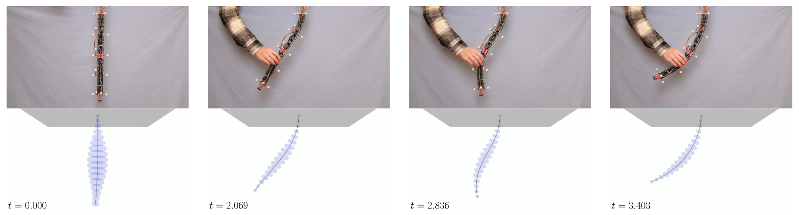
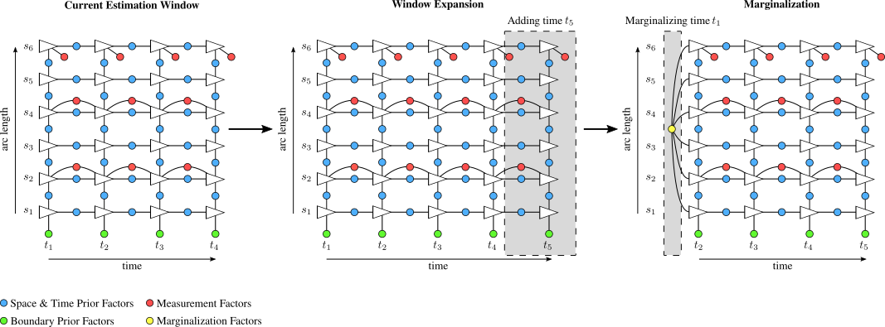

<div align="center">


<h1>Space-Time Continuum</h1>

<p>
A continuous-time-and-space state estimation framework for real-time dynamic state estimation of continuum robots.
</p>
  
<h4>
    <a href="https://arxiv.org/src/2510.26623v1/anc/results_video.mp4">View Demo</a>
    <span> · </span>
    <a href="https://github.com/utiasASRL/space_time_continuum/issues">Report Bug</a>
    <span> · </span>
    <a href="https://github.com/utiasASRL/space_time_continuum/issues">Request Feature</a>
</h4>
<h4>
    <a href="https://arxiv.org/abs/2510.01381">Paper 1</a>
    <span> · </span>
    <a href="https://arxiv.org/pdf/2510.26623">Paper 2</a>
    <span> · </span>
    <a href="https://www.roboticsproceedings.org/rss22/p050.pdf">Paper 3</a>
</h4>
</div>

<br />

<!-- Table of Contents -->
# Table of Contents

- [About](#about)
- [Getting Started](#toolbox-getting-started)
  - [Prerequisites](#prerequisites)
  - [Installation](#installation)
    - [Using spacetime from another CMake project](#using-spacetime-from-another-cmake-project)
  - [Running Tests](#running-tests)
  - [Run Demos](#run-demos)
- [Contributing](#contributing)
- [FAQ](#faq)
- [Publications](#publications)
- [Contact](#contact)
- [Acknowledgements](#acknowledgements)
- [License](#license)

<br>

## About

Space-Time Continuum is a continuous-time-and-space estimator for real-time estimation of continuum robots. It achieves real-time runtime with performance that is competitive with state-of-the-art estimation methods. The full breakdown of the theory behind this work, along with details on how to cite this package, can be found in works cited in the [publications](#publications) section. This project remains active with further releases expected in the coming months and years.

### Technical Description

The estimation framework proposed uses a maximum a posteriori (MAP) framework solved via factor-graph optimization. A series of prior factors are proposed which approximate the spatial and temporal dynamics of a Cosserat rod. Three individual solver types are implemented: batch, filter, and sliding-window filter estimators. The two filter-based solvers use an expanding / marginalizing approach to factor-graph construction highlighted in the figure below.



The batch solver cannot grow in size nor does it support marginalization, but rather, performs estimation over a fixed time period. As the estimator is formulated through a factor-graph, it is easy for users to add their own custom factors to integrate sensors and measurement models that are not initially included in this package. If you write a measurement factor for your own work that you feel would be valuable for other researchers, feel free to open a pull request and we can see about adding it to the repository! For more information, see the [contributing](#contributing) sections. For a complete description of the implementation, please see our [publications](#publications).

### When to Use Each Solver

| Scenario / Requirement | Batch                                                                                                                        | Filter                                  | Sliding Window Filter                                                                                    |
|------------------------|------------------------------------------------------------------------------------------------------------------------------|-----------------------------------------|----------------------------------------------------------------------------------------------------------|
| Best for               | Offline problems with short durations that use sensors that are robust to local minima (e.g. FBGS, electromagnetic trackers) | Compute limited, real-time applications | Real-time applications using sensors that are susceptible to local minima (e.g. time-of-flight, cameras) |
| Computational cost     | High                                                                                                                         | Low                                     | Medium-Low depending on window size                                                                      |
| Accuracy               | Highest provided a convex problem. Susceptible to local minima                                                               | Lowest                                  | Good                                                                                                     |

<br>

## Getting Started

This project has been developed and tested in Ubuntu 24.04 LTS. Other Linux distributions are expected to also work, though Windows and MacOS are not.

### Prerequisites

This repository relies on several third party packages listed below that each need to be installed prior to use. The versions numbers provided are the ones this work has been tested and developed with, small variations to version numbers may still work but remain untested.

- [Cmake](https://cmake.org/)
- [Eigen 3.4](https://libeigen.gitlab.io/)
- [VTK 9.3](https://vtk.org/)
- [Qt 6.8.0](https://contribute.qt-project.org/)
- [GTSAM](https://gtsam.org/)

### Installation 

```bash
git clone https://github.com/utiasASRL/space_time_continuum 
cd space_time_continuum
./build_release.sh 
```

#### Using spacetime from another CMake project

spacetime can be installed as a CMake package so other projects (e.g. `papers/rss2026_tof`) can build against it without depending on this repository's layout:

```bash
cmake -B build -DMarchNative=OFF -DVisualizer=ON
cmake --build build -j$(nproc)
cmake --install build --prefix <install-prefix>
```

This installs the headers to `<install-prefix>/include/spacetime`, the libraries to `<install-prefix>/lib`, and the package files to `<install-prefix>/lib/cmake/spacetime`. A downstream project then uses:

```cmake
find_package(spacetime 1.0 REQUIRED)
target_link_libraries(my_target PRIVATE spacetime::estimator)
# Every built interface (see "Selecting an interface" below)
target_link_libraries(my_target PRIVATE spacetime::interfaces)
if(spacetime_VISUALIZER)
    target_link_libraries(my_target PRIVATE spacetime::visualizer)
endif()
```

and is configured with spacetime on the search path (not needed if it was installed to a default prefix, e.g. `/usr/local`):

```bash
cmake -B build -DCMAKE_PREFIX_PATH=<install-prefix>
```

Notes:

- `spacetime::visualizer` only exists if spacetime was built with `-DVisualizer=ON`; the package sets `spacetime_VISUALIZER` accordingly.
- `spacetime::standalone` only exists if spacetime was built with `-DInterfaceStandalone=ON` (the default); the package sets `spacetime_INTERFACE_STANDALONE` accordingly.
- `-march=native` changes Eigen's memory alignment, so GTSAM, spacetime and the downstream project must all agree on it. The package sets `spacetime_MARCH_NATIVE` to how spacetime was built; downstream projects should add `-march=native` exactly when it is true.
- Headers are included as `#include <spacetime/...>`, e.g. `<spacetime/estimator/Estimator.hpp>`.
#### Threading and interfaces

The interface layer (`spacetime/interface/`) defines what every interface builds on, without handling any threads itself: an `Interface::Clock`, `Interface::Dataloader`s with a delivery watermark, an `Interface::EstimationSchedule` (when to estimate) and an `Interface::EstimatorDriver` (one `step(time)` per estimate). Each interface decides how threads are handled; e.g. a ROS2 node would call `EstimatorDriver::step` from its own timer. The standalone interface runs these threads:

| Thread | Priority | Role |
|---|---|---|
| Control (`main()`) | default | Owns the lifecycle: builds the models, starts, stops and joins the other threads. |
| Estimator | default (highest) | `Standalone::EstimatorRunner`: steps the estimator once per period, paced by a `Standalone::PacingClock`. |
| Dataloader(s) | default | One `Standalone::ThreadedDataloader` each (e.g. `Standalone::FileDataloader`), filling the models' measurement queues. |
| Visualizer (optional, not with `--headless`) | lowered | `Visualization::Default::VisualizerThread`: owns every Qt/VTK object and reads the estimator's published snapshots. |
| Queries (optional) | lowered | Read results through `Estimator::getSnapshot()` / `waitForSnapshotNewerThan()`, or an `Interface::SnapshotHistory`. |

Offline (`Standalone::SteppedClock`), the estimator steps as fast as possible and waits for every dataloader to deliver its data up to each step, so results are deterministic. In real time (`Standalone::WallClock`), it never waits on data.

Interfaces are build-time options, each implementing the layer under `spacetime/interface/<name>/`:

| Option | Default | Interface |
|---|---|---|
| `InterfaceStandalone` | `ON` | Replays recorded files (`Standalone::FileDataloader`), as fast as possible or in real time (`--online`). Used by the demos. |
| `InterfaceMujoco` | `OFF` | Live, through Mujoco. Not implemented yet. |
| `InterfaceROS2` | `OFF` | Live, through ROS2. Not implemented yet. |

The Qt visualizer runs on a worker thread, which Qt supports on Linux but not on macOS. `-DVisualizer=ON` requires `-DInterfaceStandalone=ON`.

**Selecting an interface.** Interfaces are swappable by changing one line. Each interface declares a bundle `Spacetime::Interfaces::<Name>` satisfying the `Spacetime::Interface::InterfaceType` concept (`spacetime/interface/InterfaceConcept.hpp`, which documents every hook): a `name` and a `Session` that is constructed from the estimator and `Interface::SessionOptions`, and that is given the models' measurement queues and run with `start()` / `requestStop()` / `join()`. Downstream code links `spacetime::interfaces`, includes every built interface at once and selects one:

```cpp
#include <spacetime/interface/Interfaces.hpp>
using SelectedInterface = Spacetime::Interfaces::Standalone; // the only interface-specific line

Spacetime::Interface::SessionOptions options; // start_time, end_time, period, real_time
SelectedInterface::Session session(estimator, options);
session.addMeasurementQueues(estimator.getMeasurementQueues());
session.start();
session.join();
```

The demos (`examples/*.cpp`, `papers/*/main.cpp`) are written this way.

<!-- 
To run the unit tests, 

```bash
./run_tests
``` -->

Lastly, to run paper demos, use the following 

```bash
./run_demo <estimator> <robot_number> <trial>
```

Where \<estimator> is one of either "batch", "window", or "filter". \<robot_number> specifies which robot configurations to use (either 1 or 2). \<trial> refers to a specific trial from one of the publications. See below for more information.

<details>
<summary> Trial information </summary>

Four robots are used in the following trials. Their descriptions are as follows:

| Robot number | Used in papers | Description                                                                                     |
|--------------|----------------|-------------------------------------------------------------------------------------------------|
| 1            | [1], [2]       | A simulated extensible continuum robot with four distributed pose sensors. The robot is fixed at the base. The robot is 1 unit long. |
| 2            | [1], [2]       | A real, non-extensible, two segment tendon-driven continuum robot (TDCR) with a pose sensor at its tip. The robot is fixed at the base. The robot has a nitinol backbone, 3D printed stiffening units, and is 46.6cm long. |
<!-- | 3            | [3]            | A simulated, non-extensible, three segment TDCR. The robot has a strain sensor every 3cm, and a ring of 3 time-of-flight sensors radially mounted every 30cm. Each ring also has a gyroscope sensor. The tip additionally has ToF sensor pointing forwards. The robot is 1.5m long and has an insertion degree of freedom at its base, allowing for motion in the x direction. |
| 4 | [3] | A real, extensible, three segment 3D printed TDCR. The robot has three sensor rings, each equipped with three radially mounted ToF sensors and an IMU. The robot is fixed at the base and is 53cm long in its resting position. |   -->

| Trial name    | Used in papers | Robot number | Description |
|---------------|----------------|-------------|---|
| extensible    | [1], [2]       | 1 | A trajectory where the robot begins completed contracted, extends to full length, and then contracts fully again. |
| out_of_bounds | [1], [2]       | 2 | A trajectory where the pose sensor data drops out periodically when the robot moves out of the sensor's range. |
| fast_contact  | [1], [2]       | 2 | A trajectory where aggressive external forces are applied. The robot is periodically grabbed and shaken by the operator, applying sustained external forces. | 
| impulse_1 | [1], [2] | 2 | A trajectory where aggressive external forces are applied. The robot is periodically hit by the operator, inducing abrupt external laods. |
| impulse_2 | [1], [2] | 2 | A trajectory where aggressive external forces are applied. The robot is periodically hit by the operator, inducing abrupt external laods. |
| slow_free_space | [1], [2] | 2 | A trajectory where the robot is actuated with no external loads applied, slowly moving through the workspace. | 
<!-- | engine_inpsection_1 | [3] | 3 | One of three trajectories that have the robot moving into and around a simulated jet engine inspection environment. |
| engine_inpsection_2 | [3] | 3 | |
| engine_inpsection_3 | [3] | 3 | | -->

**Notes:**

- Demos for [3] to be added at a later time.
- Small changes have been made to the code base and configurations that have resulted in small deviations in the results from the original published works. The conclusions of each work remain unchanged. Older versions of the project that have been used in each of the works can be made available upon request, though as with many early research projects, user-friendliness was not a priority at the time.

</details>

<br>

#### Joining robots

A `Spacetime::Joints::Joint` (`spacetime/estimator/joint_models/Joint.hpp`) is a model that joins two robots. It holds the point at arclength `s_a` on robot A to the point at `s_b` on robot B, optionally through an offset `T_AB` (`T_B = T_A T_AB`). It softly locks either the full pose (`JointType::Rigid`) or only the position (`JointType::Spherical`), and the velocities of the two points whenever both robots have them. The joint points may lie between nodes, and the offset covariance must be positive-definite, so hard constraints are not supported. Each robot's prior is found through its state, so construct the priors first:

```cpp
auto joint = std::make_shared<Spacetime::Joints::Joint<WNOAPrior, WNOAPrior>>(
    robot_a, s_a, robot_b, s_b, offset_covariance, options); // options: type, offset, velocity_sigma_floor
estimator.addModel(joint);
```

Several robots can also attach to one `Spacetime::Joints::EndEffector` (`spacetime/estimator/joint_models/EndEffector.hpp`). This is a rigid body with no length, holding only a pose and a velocity, and it is linked over time by GTSAM's WNOA motion factors. It has no anchor of its own: the robots attached to it position it, and estimating it with none attached throws. It owns its prior and its joints, so a single `addModel` registers all of them:

```cpp
auto platform = std::make_shared<Spacetime::Joints::EndEffector<gtsam::Pose3>>(initial_pose);
platform->attach(robot_prior, s, offset_covariance, options); // options.offset = T_point_ee; returns the Joint
estimator.addModel(platform);
```

Three hard-coded demos use it. Each runs a batch estimate, prints how well every joint holds, and replays the result in the visualizer. `--headless` skips the visualizer, and `--output <dir>` writes the estimate to `<dir>` (used by the Python regression test).

```bash
./build/examples/robot_joining [--headless] # robot A's tip joined to robot B's mid-point through a short link; B is driven into an S shape
./build/examples/stewart_gough [--headless] # six legs of a Stewart-Gough platform, their tips attached to an end effector, actuated by elongation
./build/examples/robot_joining_parallel [--headless] # two fixed-base, unshearable legs whose tips share an end effector, swung 27 cm sideways; only the end effector's pose is measured
```

In the visualizer, a joint is drawn as a black cylinder between the joined points, or as a black sphere when it has no offset, and an end effector as a coordinate frame. `N` toggles the joints and `E` the end-effector frames.

#### Python

The `spacetime` Python package exposes the library: priors (`priors.wnoa`, `priors.wnov`, `priors.wnoa_quasi_static`) and their grid states, sensors, joints and end effectors, the estimator, the standalone session and the visualizer, with all of their options. GTSAM objects (`gtsam.Pose3`, `gtsam.Values`, factors, noise models) are GTSAM's own Python types, so GTSAM's Python module must be installed, built from the same GTSAM as the C++ library (`GTSAM_BUILD_PYTHON=ON`). The bindings must be built with the pybind11 version GTSAM's wrapper uses; it is pinned in `python/requirements.txt`.

```bash
pip install -r python/requirements.txt
./build.sh --python                 # builds the bindings and pip-installs `spacetime` (into .venv if present)
python -m pytest python/tests       # also run by ./test.sh once the bindings are built
```

Every C++ base class can be subclassed in Python: `types.Model`, `types.SensorBase` (override `getFactor`), `types.ActuatorBase`, `types.StatefulModel` (e.g. a prior: override `extendState`), `types.State`, `types.NodeBase` and `types.NodeValues`, as well as the built-in priors and sensors. `types.Robot` is a plain list of models, for `Estimator.addRobot`. Python models build their factors from existing C++ factors, GTSAM's (e.g. `gtsam.PriorFactorPose3`) or the library's (`sensors.PoseFactor`, `sensors.StrainFactor`, `sensors.GyroFactor`), so factor evaluation stays in C++:

```python
import gtsam
from spacetime import sensors, types

class MyPoseSensor(types.SensorBase):
    def getFactor(self, measurement):
        noise = gtsam.noiseModel.Gaussian.Covariance(measurement.covariance)
        return sensors.PoseFactor(noise, gtsam.Pose3(measurement.value), measurement.mask)
```

As in C++, a robot is its grid state (e.g. `wnoa.ContinuumRobotState(length, nodes)`, which holds its locks) plus the prior that extends it; sensors and joints are built on the prior. A state does not own its prior: keep a reference to each prior while it is in use. The joining demos are ported to `python/examples/` (`robot_joining.py`, `robot_joining_parallel.py`, `stewart_gough.py`, with the same options), along with `custom_sensor.py`; `python/tests/test_demo_regression.py` checks that they reproduce the C++ demos' estimates.

## Contributing

We are open to contribution from third parties! Please use the following

### Adding a new measurement factor type

If you have developed a new measurement factor that you think others would find useful, feel free to open a pull request including the new factor! To make a new factor, it must inherit the ``Spacetime::Factors::MeasurementFactor`` class. The mandatory functions ``getError`` and ``getJacobian`` must be implemented. Please see existing measurement factors and [this example](examples/custom_factor) for reference. In your pull request please include:

- The factor implemented in a single include/spacetime/factors/\<factorname\>.hpp file
- A description at the top of the file of what this factor is for. Include any specific requirements on the data format, hardware, etc.
- \[Optional\] Information at the top of the file of how to cite you

### Other contributions 

Please [open an issue](https://github.com/utiasASRL/space_time_continuum/issues) to raise collaboration ideas and feature requests.

<br>

## FAQ

<details>
<summary><strong>Who is this project for?</strong></summary>

The project in its current state remains research focused. It is meant for individuals who are working in state estimation or otherwise need a stochastic state estimator in their work.

</details>

<details>
<summary><strong>Is this code production-ready?</strong></summary>

This code has been used and tested in a research environment. While the system is fast enough to run in real-time, and an interface layer for live use is provided (see [Threading and interfaces](#threading-and-interfaces)), only file playback is implemented on it so far. Caution is advised for researchers wishing to use this repository in any closed-loop control applications, as no formal safety guarantees are currently implemented. If you are a researcher and looking to use it in such an application, feel free to reach out to see if a collaboration is possible.

</details>

<details>
<summary><strong>How do I cite this work?</strong></summary>

See the [Citing](#publications) section of this README.

</details>

<details>
<summary><strong>I found a bug — what should I do?</strong></summary>

Please open an issue:
https://github.com/utiasASRL/space_time_continuum/issues

</details>


<br> 

## Publications

If you find this repository useful in your work, please consider citing the contributions that have made this repository possible.

---

### 📕 [1] A Stochastic Framework for Continuous-Time State Estimation of Continuum Robots

**Spencer Teetaert, Sven Lilge, Jessica Burgner-Kahrs, and Timothy D. Barfoot (2025)**

❓ This is the seminal work, introducing the batch estimation framework implemented in this repository. 

🔗 [https://arxiv.org/abs/2510.01381](https://arxiv.org/abs/2510.01381)


<details>
<summary>Abstract</summary>
State estimation techniques for continuum robots (CRs) typically involve using computationally complex dynamic models, simplistic shape approximations, or are limited to quasi-static methods. These limitations can be sensitive to unmodelled disturbances acting on the robot. Inspired by a factor-graph optimization paradigm, this work introduces a continuous-time stochastic state estimation framework for continuum robots. We introduce factors based on continuous-time kinematics that are corrupted by a white noise Gaussian process (GP). By using a simple robot model paired with high-rate sensing, we show adaptability to unmodelled external forces and data dropout. The result contains an estimate of the mean and covariance for the robot's pose, velocity, and strain, each of which can be interpolated continuously in time or space. This same interpolation scheme can be used during estimation, allowing for inclusion of measurements on states that are not explicitly estimated. Our method's inherent sparsity leads to a linear solve complexity with respect to time and interpolation queries in constant time. We demonstrate our method on a CR with gyroscope and pose sensors, highlighting its versatility in real-world systems. 
</details>
<details>
<summary>BibTeX</summary>

```bibtex
@article{Teetaert2025b,
  title={A Stochastic Framework for Continuous-Time State Estimation of Continuum Robots}, 
  author={Spencer Teetaert and Sven Lilge and Jessica Burgner-Kahrs and Timothy D. Barfoot},
  year={2025},
  eprint={2510.01381},
  archivePrefix={arXiv}
}
```

</details>

---

### 📕 [2] A Sliding-Window Filter for Online Continuous-Time Continuum Robot State Estimation

**Spencer Teetaert, Sven Lilge, Jessica Burgner-Kahrs, and Timothy D. Barfoot (2025)**

❓ This work extends the project to enable online estimation. It introduces both the filter and sliding window filter, as well as state marginalization. 

🔗 [https://arxiv.org/abs/2510.26623](https://arxiv.org/abs/2510.26623)

<details>
<summary>Abstract</summary>
Stochastic state estimation methods for continuum robots (CRs) often struggle to balance accuracy and computational efficiency. While several recent works have explored sliding-window formulations for CRs, these methods are limited to simplified, discrete-time approximations and do not provide stochastic representations. In contrast, current stochastic filter methods must run at the speed of measurements, limiting their full potential. Recent works in continuous-time estimation techniques for CRs show a principled approach to addressing this runtime constraint, but are currently restricted to offline operation. In this work, we present a sliding-window filter (SWF) for continuous-time state estimation of CRs that improves upon the accuracy of a filter approach while enabling continuous-time methods to operate online, all while running at faster-than-real-time speeds. This represents the first stochastic SWF specifically designed for CRs, providing a promising direction for future research in this area.
</details>
<details>
<summary>BibTeX</summary>

```bibtex
@inproceedings{Teetaert2026a,
  title={A Sliding-Window Filter for Online Continuous-Time Continuum Robot State Estimation}, 
  author={Spencer Teetaert and Sven Lilge and Jessica Burgner-Kahrs and Timothy D. Barfoot},
  booktitle={2026 IEEE 9th International Conference on Soft Robotics (RoboSoft)}, 
  year={2026},
  pubstate={forthcoming}
}
```

</details>

---

### 📕 [3] Continuum Robot Localization using Distributed Time-of-Flight Sensors

**Spencer Teetaert, Giammarco Caroleo, Marco Pontin, Sven Lilge, Jessica Burgner-Kahrs, Timothy D. Barfoot, and Perla Maiolino (2026)**

❓ This work introduces time-of-flight factors to the framework, enabling real-time localization of continuum robots.

🔗 [https://arxiv.org/abs/2602.07209](https://arxiv.org/abs/2602.07209)

<details>
<summary>Abstract</summary>
Localization and mapping of an environment are crucial tasks for any robot operating in unstructured environments. Time-of-flight (ToF) sensors (e.g.,~lidar) have proven useful in mobile robotics, where high-resolution sensors can be used for simultaneous localization and mapping. In soft and continuum robotics, however, these high-resolution sensors are too large for practical use. This, combined with the deformable nature of such robots, has resulted in continuum robot (CR) localization and mapping in unstructured environments being a largely untouched area. In this work, we present a localization technique for CRs that relies on small, low-resolution ToF sensors distributed along the length of the robot. By fusing measurement information with a robot shape prior, we show that accurate localization is possible despite each sensor experiencing frequent degenerate scenarios. We achieve an average localization error of 2.5cm in position and 7.2° in rotation across all experimental conditions with a 53cm long robot. We demonstrate that the results are repeated across multiple environments, in both simulation and real-world experiments, and study robustness in the estimation to deviations in the prior map.
</details>
<details>
<summary>BibTeX</summary>

```bibtex
@article{Teetaert2026b,
  title={Continuum Robot Localization using Distributed Time-of-Flight Sensors},
  author={Spencer Teetaert and Giammarco Caroleo and Marco Pontin and Sven Lilge and Jessica Burgner-Kahrs and Timothy D. Barfoot and Perla Maiolino},
  year={2026},
  eprint={2602.07209},
  archivePrefix={arXiv}
}
```

</details>

<br>

## Contact

This project is maintained by Spencer Teetaert  
Affiliation: [Autonomous Space Robotics Lab](http://asrl.utias.utoronto.ca/) and [Continuum Robotics Lab](https://crl.utm.utoronto.ca/), University of Toronto 

- Email: spencer.teetaert@robotics.utias.utoronto.ca
- Website: https://spencerteetaert.github.io/

Bug reports and feature requests should be submitted through GitHub Issues.

<br>

## Acknowledgements 

This project would not be possible without the support of many collaborators, open-source projects, and funding agencies, including:
* The Natural Sciences and Engineering Research Council of Candada (NSERC)
* My co-authors and collaborators, especially Sven Lilge, whose [project](https://github.com/SvenLilge/Continuum-MultiRobot-Estimation) provides the foundation for this work. 
* My colleagues from both CRL and ASRL who have provided feedback and support
* All the projects used in this work that are supported by the open-source community ([Eigen](https://libeigen.gitlab.io/), [VTK](https://vtk.org/), [GTSAM](https://gtsam.org/), [Qt](https://contribute.qt-project.org/))

<br>

## License 

This project is freely distributed under the MIT license. Please refer to [LICENSE.txt](LICENSE.txt) for more information.
